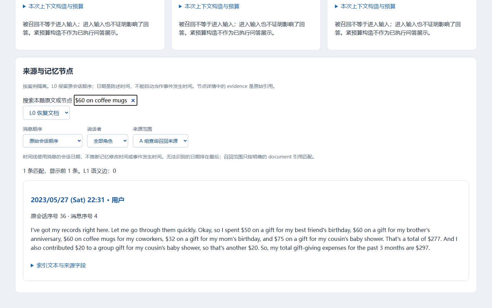

# 文智豪平台展示素材

平台演示回答三个问题：任务需要哪条信息，信息来自哪段对话，运行记录中怎样使用。选取 LongMemEval 档案中 **0100672e 咖啡杯费用**，因为问题、来源和回答可以逐项核对。该案例是精选成功记录，不能用来推算总体准确率或记忆增益。

## 总结页用一张截图

图注建议写：“LongMemEval 离线运行档案公开副本；A 组召回来源中找到用户原话‘给同事买杯子共花 60 美元’。此图显示来源定位，不代表在线 Memory 服务或语义关系边。”截图来自 2026 年 11 月 9 日实际页面，没有修改研究文本。PPT 可在图外用三个短标签指向“召回范围”“用户原文”“原会话时间”。

## 一段精简演示

[播放约十秒的平台录屏](videos/文智豪-杯子费用来源到回答.webm)。录屏按**问题 → A 组召回来源中的用户原话 → A/B/C 第一轮回答**的顺序展示；页面只读，未执行新模型调用。用户原话记录 5 个杯子共 60 美元，第一轮三组归档回答均为每个 12 美元，归档评分标为正确。若在答辩中口述，可说：“观众先看到任务需要的费用信息，再看到它来自哪段原话，最后核对实际回答。”

这段记录能说明展示如何追溯来源与回答。A、B、C 的第一轮上下文均包含费用信息，不能仅凭正确标签断言 L1 层或画像提供了额外收益。记录中的召回与注入需要分开看；来源出现也不等于它实际影响了答案。

## 三种页面状态的界限

- **真实离线数据：** 上图和主录屏使用归档的会话、召回、上下文、回答；只读，不能在此编辑记忆。另见[记忆总览截图](images/用户指南-真实记忆总览.png)。
- **本机只读快照：** “经验快照”入口由使用者在浏览器内选择本机文件；未上传且来源未独立核验。没有导入文件时，不把该页面当成真实运行记录。
- **MOCK 模拟操作：** [更新截图](images/用户指南-MOCK更新.png)和[约八秒演练录屏](videos/用户指南-MOCK更新演练.webm)展示内存副本的修改；“思维导图”中的版本、撤回和命中标记也只是演练。刷新或重置会恢复原状态，真实档案不会改写。

建议答辩先播放主录屏，再用总结页截图停留讲解。若需要补充界面交互，可展示 MOCK 更新录屏，并在投影图注中始终保留“MOCK”。用户操作步骤已单独写在[第 5 章用户指南](文智豪-用户指南第5章.md)；该章只讲操作、截图与常见问题。
