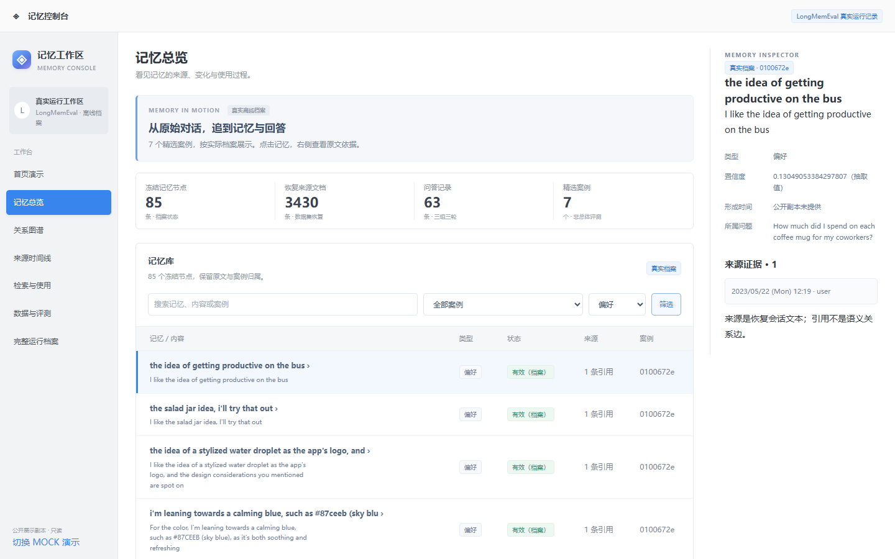
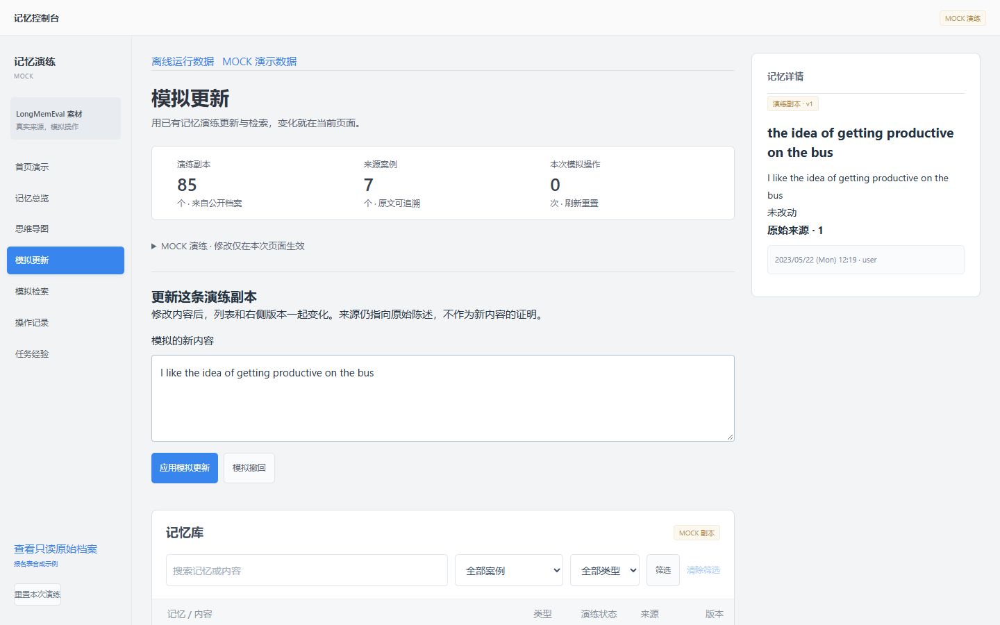

# 5 用户指南（文智豪负责部分）

本章说明当前 Memory Console 展示版怎样打开、查阅记忆及其来源，并演练更新和撤回。页面有两种明确区分的工作模式：**离线运行数据**是已导出的 LongMemEval 档案公开副本，只读；**MOCK 演示数据**借用该档案的素材，在当前浏览器内模拟操作。本文截图来自 2026 年 11 月 9 日的实际构建页面，不代表团队实时 Memory 服务的界面或能力。

## 5.1 打开与快速开始

1. 在浏览器打开 [Memory Console](https://lingzhongyu123.github.io/competition-/index.html)。首页是独立的报名表合成故事；需要查看运行记录时，直接打开 [记忆总览](https://lingzhongyu123.github.io/competition-/index.html#memories)。
2. 核对页首 **“LongMemEval 真实运行记录”**。统计区显示当前公开档案的范围，不是当前用户的在线记忆数量。
3. 在记忆库中点击一条标题，右侧“记忆详情”显示摘要、类型、所属问题和原始来源。点击来源的日期行可展开原文。

图 5-1：公开展示副本的真实页面。数据来自用户提供的离线运行档案；形成时间未在公开副本中提供，页面明确显示缺失。图中的“有效”是档案状态，不等于人工核验正确。

## 5.2 查看事实与偏好

在“记忆总览”的记忆库中，可输入关键词并按案例、类型筛选，然后点击“筛选”。例如，选择“偏好”后，列表仅显示该类型的条目。表格显示记忆摘要、类型、档案状态、来源引用数和案例编号；底部“上一页”“下一页”浏览更多条目。类型名称来自档案，不能把所有节点都解释为已核实的个人事实。

图 5-2：真实离线档案的只读筛选界面。筛选不修改原始记录；“有效”是档案状态。

点击某条记忆后，右侧详情会显示该节点的原始引用。需要查看消息与记忆的关联时，进入左侧“关系图谱”，点击节点可查看关联的来源引用。

如需查看其他类型，调整“全部类型”下拉项后重新点击“筛选”。

## 5.3 搜索记忆与查看来源

1. 在“记忆总览”输入关键词，选择案例或类型并点击“筛选”；点击结果标题可查看来源原文。筛选只是前端查阅记录，不代表本轮重新调用了记忆检索服务。
2. 从侧栏打开“检索与使用”，查看所属案例已保存的 A、B、C 三组、各三轮回答及档案评分。若要核对实际上下文与检索顺序，进入[完整运行档案](https://lingzhongyu123.github.io/competition-/longmemeval-public.html)选定同一案例和轮次，展开“实际上下文”及“查询召回顺序与来源”。
3. “找到候选”“进入实际上下文”“回答正确”是页面中不同的记录，查看时分别核对。

## 5.4 更新与遗忘演练

当前公开运行档案是只读的。要展示“更新与遗忘”的页面交互，可在真实工作区左下角点击“切换 MOCK 演示”，再从侧栏进入“模拟更新”。

1. 在演练记忆库中选中一条副本，输入新的演示内容，点击“应用模拟更新”。列表和右侧详情会显示更新后的 v2，同时保留原档案摘要供对照。
2. 点击“模拟撤回”演示遗忘操作，该副本在本次演练中变为撤回状态；再打开“模拟检索”，用关键词查找，可观察撤回后不再进入本次匹配结果。
3. 从“操作记录”查看本次模拟动作；点击“重置本次演练”或刷新页面，演练状态恢复。

图 5-3：实际页面截图，操作为 **MOCK**。更新、撤回与关键词匹配均不写回真实档案，也不证明后端完成了长期记忆更新或存储层遗忘。原始来源只支持旧内容，不能为新输入的演示内容背书。

“思维导图”按 7 个案例展开记忆及原始引用，可用放大、缩小和适应窗口查看。模拟更新后出现版本分支，模拟撤回后节点变灰，模拟检索命中以边框标示；这些都是演练状态。

## 5.5 常见问题

**打开后看不到 85 条记忆。** 确认进入的是“记忆总览”的真实运行模式，而非首页故事或 MOCK 演练；检查页面顶部来源标识。列表每页只显示部分记录，其他条目用分页和筛选查看。

**点“模拟更新”后，真实档案为什么没有变化。** 该操作只作用于当前浏览器的 MOCK 副本；通过左下角“查看只读原始档案”返回真实模式，原档案应保持不变。

**为什么某条记忆看起来与当前问题无关。** 页面展示的是该案例冻结图谱中的节点，不能据此认定该节点被该轮问题召回。到完整运行档案核对具体轮次的查询召回和实际上下文。

**能否证明系统已在 DSH 中实时工作。** 当前网页使用公开离线档案，DSH 伴随插件仅做过隔离环境的页面挂载验证；团队部署和实时 Memory 接口仍待联调。

**手机上怎样查看详情。** 在 MOCK 工作区点选记忆后，使用“查看详情”打开独立详情面板；可用“关闭”或 Escape 返回。真实运行页可点击列表条目查看详情。
